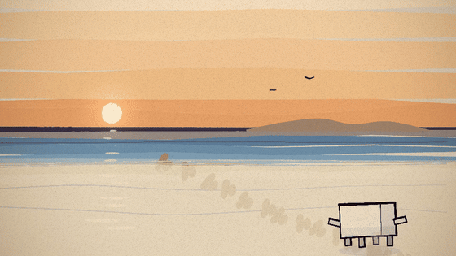
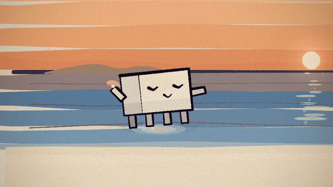

# 潮汐 — a hand-painted animation made in code


 

An animated short (165 s, 9 shots, 24 fps) made for the song **《潮汐 (Natural)》**
(IN-K / 安苏羽 / 傅梦彤, 词 安苏羽 · 舒心, 93 BPM, 4/4).

Every frame is **drawn as code** — flat gouache washes and thin ink brush strokes on paper
grain, composed so the whole film sits on the song's bar grid. No image-generation model,
no video editor, no stock footage: `p5.js` + `p5.brush` paint each frame as a pure function
of time, headless Chromium renders them, ffmpeg encodes them.

> **Install of record:** this is the `painted-animation` skill by **tuzhechen2005**
> (repo `tuzhechen2005/opus-video-skills`, skill at `skills/painted-animation/`, installed
> here as `.claude/skills/painted-animation/`). Its engine (`template/`) comes from
> **ClaudeAnimationBase** by John Heibel (MIT), which grew out of his PDoomVideo. The skill
> supplies the method, the engine and the review loop; the story, the art vocabulary and
> all nine shots are this project's.

## The film

One coast at nine hours of light — **dusk → sunset → night → before dawn → sunrise** —
and a trail of footprints the sea keeps taking.

| # | bars | s | shot | the read |
|---|---|---|---|---|
| 1 | 0–8 | 0–21 | 潮线 | she walks a trail of prints down the beach; the water takes the trail behind her |
| 2 | 8–16 | 21–41 | 寻找昔日的足迹 | she runs the trail; it stops at a shell in the sand |
| 3 | 16–22 | 41–57 | 夕阳下倒影 | she walks through the sun's reflection; it breaks under her and closes again |
| 4 | 22–28 | 57–72 | 分享给大海秘密 | the shell to her ear; the water answers in rings and a line of light |
| 5 | 28–32 | 72–83 | 蓝色的海底 | the shell falls past the camera into the deep, the light closing overhead |
| 6 | 32–40 | 83–103 | 远山的风景 | it drifts away between two far shores, and the shores pull apart |
| 7 | 40–48 | 103–124 | 退守的爱情 | she draws two figures in the sand; a wave takes one of them |
| 8 | 48–56 | 124–145 | 疯狂的寻觅你的身影 | she crosses the night beach with a lamp, and the sea takes her own prints |
| 9 | 56–64 | 145–165 | 残月忧郁 星夜辽阔 | the moon in every tide pool; she kneels at one, the wind takes the surface, the moon goes out of the water |

Full shot-by-shot plan with each shot's timed **reads**: [`STORYBOARD.md`](STORYBOARD.md).

## Watch it

- **`out/video.mp4`** — the film, committed in this repository (45.9 MB, rendered by
  `node render.mjs --encode`). It is the exact file to watch; it is also the file that
  would be attached to a GitHub Release (the sandbox this was rendered in cannot reach
  `uploads.github.com`, so the asset could not be uploaded from here — the file is in the
  repo instead).

**Это version is silent.** The song is someone else's work, so its audio is not
redistributed here. To hear the film with the song, put your own copy in `assets/song.mp3`
and re-encode the frames:

```bash
node render.mjs --encode --out=out/video.mp4 --audio=assets/song.mp3
```

The timing was built for it: `src/config.js` sets `bpm = 93`, `BAR = 4 beats`, and every
shot boundary, every foam edge and every beat-locked movement sits on that grid. The film's
own lyric cues (line → start/end) are in [`assets/lyrics_timed.txt`](assets/lyrics_timed.txt).

## Reproduce it

```bash
bash tools/setup.sh          # toolchain: Chromium (for software GL) + static ffmpeg
npm install                  # p5, p5.brush, puppeteer-core, the bundled fonts
node tools/bundle_fonts.mjs  # build assets/fonts from @fontsource, cut to the lyrics

node render.mjs --sheet=0,20,40,60,80 --cols=3 --w=420 --out=out/check/a.jpg   # look at key frames
node render.mjs --frames --workers=2 --soft-gl                                 # all 3965 frames
node render.mjs --encode --audio=assets/song.mp3 --out=out/video.mp4           # MP4
```

| path | what |
|---|---|
| `src/scenes/_lib.js` | the film's art vocabulary: palette, coast, waves, footprints, her, the shell, transitions |
| `src/scenes/s1.js … s9.js` | one file per shot — the shots *are* the film |
| `src/core.js`, `clawd.js`, `timeline.js` | the kit's engine (see the note above) + this film's two render fixes |
| `assets/fonts/` | bundled subsets of Ma Shan Zheng (the brush CJK face for the sky and the sand is drawn, not typed — the font is only used by the UI) + the UI faces |
| `tools/` | toolchain setup, font bundling, and the performance notes |

### Notes on rendering here (no GPU, 2 vCPUs)

A 960×540 frame costs ~1.6 s of CPU on SwiftShader. `src/core.js` carries the two changes
that made a 3965-frame film affordable, and `tools/README-perf.md` has the measurements:
**cost is the number of brush dabs, not pixels**, so backgrounds are flat `wash` shapes and
only edge work uses strokes; and `canvas.toDataURL()` costs 3 s per frame versus 14 ms for
`getImageData` + `toBlob`. The character is painted from flat shapes instead of the kit's
stock mascot (8.9 s/frame → 0.2 s).

## Folders

```
stories/                 (this project) STORYBOARD.md, src/, assets/, tools/, out/
.claude/skills/painted-animation/   the installed skill (upstream, MIT)
```

## Credits & licence

- **Song and lyrics:** 《潮汐 (Natural)》 — 演唱 IN-K / 安苏羽 / 傅梦彤, 词 安苏羽 · 舒心,
  曲 IN-K. © the rights holders. The lyrics are used as the film's dramatic source; the
  recording is **not** included in this repository.
- **Skill & engine:** `painted-animation` by tuzhechen2005 (MIT); engine from
  [ClaudeAnimationBase](https://github.com/JohnHeibel/ClaudeAnimationBase) by John Heibel
  (MIT; see `.claude/skills/painted-animation/LICENSE` and `template/LICENSE`).
- **This film** (story, shots, art vocabulary, tooling notes): MIT, same spirit — take it,
  change it, repaint it.
