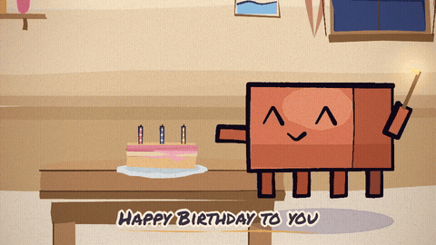

# 生日快乐 · Happy Birthday — a card for Claude


A **36-second hand-painted card**, drawn entirely in code: a warm room at night, a small cake with
three candles, and Clawd — the Claude Code character this whole kit was built for — who walks in,
lights the candles, is joined by two friends, and blows them out. The words are the song's:
four lines of *Happy Birthday* in English, four of 「祝你生日快乐」, one every two bars.

| | |
|---|---|
| length | 0:36 (24 bars, 3/4, 120 BPM) |
| picture | 960×540, 24 fps, H.264 · `out/video.mp4` (~17 MB) |
| sound | silent — add the song with `--audio=` (see below) |
| cast | Clawd ×3 (`src/clawd.js`), one cake, one night window |




## The six shots

| # | shot | bars | time | words | what happens |
|---|---|---|---|---|---|
| 1 | 空房间 | 0–4 | 0:00–0:06 | — | the room before anybody is in it; Clawd comes in and stops at the table |
| 2 | 点蜡烛 | 4–8 | 0:06–0:12 | Happy Birthday to you ×2 | he leans in with a lit taper; the three candles catch, one per beat |
| 3 | 朋友们 | 8–12 | 0:12–0:18 | …dear Claude / Happy Birthday to you | two friends arrive — balloons, a present — and he turns to wave them in |
| 4 | 合唱 | 12–16 | 0:18–0:24 | 祝你生日快乐 ×2 | the row of three sings; confetti comes down, notes go up |
| 5 | 许愿 | 16–20 | 0:24–0:30 | 祝你生日快乐 ×2 | one puff, three flames out, three curls of smoke; the light turns cold |
| 6 | 贺卡 | 20–24 | 0:30–0:36 | 生日快乐 / Claude | the camera steps back and the card is written across the room |

## Where the beats come from

The song is a **waltz**: 3/4 at 120 BPM, so `BEAT = 0.5 s` and `BAR = 3 × BEAT = 1.5 s`
(`src/scenes/_lib.js` — the one thing this film does differently from 潮汐, which is in common time).
The picture is cut on that grid: two bars of intro, then one lyric line every two bars.

## Making it

```bash
bash tools/setup.sh                 # Chromium + ffmpeg into ~/.toolchain (no root needed)
export CHROME_PATH=$HOME/.toolchain/chrome-root/chrome
export LD_LIBRARY_PATH=$HOME/.toolchain/al2023/lib
export PATH=$HOME/.toolchain/bin:$PATH

node render.mjs --sheet=2,6,10,14,18,22,26,30,34 --cols=3 --w=480 --soft-gl --out=out/sheet.jpg
node render.mjs --frames --workers=3 --soft-gl      # ~1.6 s/frame on this box → ~24 min
node render.mjs --encode --out=out/video.mp4        # 864 frames → 36 s

# with the song:
node render.mjs --encode --audio=assets/song.mp3 --out=out/video.mp4
```

Open `studio.html` in a browser to scrub the whole thing (no server needed), or
`studio.html?loop=emotions` for the character's model sheet.

## Two things added to the engine for this film

* **Flat mode** (`PROJECT.flat` → `FLAT` in `src/core.js`). The stock `clawd()` is watercolour:
  ~8.9 s a frame, which no full film can afford (see `tools/README-perf.md`). Flat mode folds every
  watercolour `fill` into the flat `wash` that would have averaged the same colour, drops hatching
  and caps stroke weight — same silhouette and palette, about a seventh of the cost, and it is what
  makes a Clawd-led film renderable at all.
* **Sung words** (`lyricLine()` in `src/scenes/_lib.js`). Each line gets a fat cream halo (so it sits
  on whatever it crosses), a pop-in from the middle, and a gold brush underline that grows with it —
  no black band, so the painting stays visible behind the words.

## Credits

* character kit, paper, grain, lettering, renderer: **ClaudeAnimationBase** by John Heibel (MIT) —
  the `clawd.js` / `core.js` / `render.mjs` engine of this repo.
* the approach (paint a film in code with p5.brush + Puppeteer + ffmpeg): the **painted-animation**
  skill by tuzhechen2005.
* 《生日快乐 / Happy Birthday》 — traditional.

The film is silent here: the song is not ours to ship. Drop an audio file in `assets/` and pass
`--audio=` to mux it in; the cut is already on the bar grid, so it lands on the beats.
